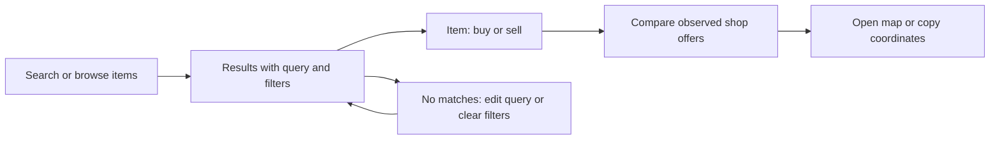

# Economy Explorer: design system and experience redesign

Reviewed 20 October 2026. This pass combines a public browser review of
`economy.democracycraft.net`, source inspection of this checkout, and visual
inspection of Mobbin screen/flow previews. Production differs materially from
the checkout. Observations below distinguish live behavior, existing local
improvements, and proposed work. No authenticated production journeys were
tested; administrative and personal screens were reviewed in source only.

## Current direction: public dashboard

The first implementation added oversized introductions, instructional steps,
promotional links and catalogue cards. The user rejected this direction: this
is a public data dashboard. Those additions have been removed.

The overview starts with period controls and four metrics, followed by factual
chart headings. Market starts with a compact search form and a table of traded
items. The catalogue uses comparable rows for item, material, trades, quantity
and volume. On phones, item and price/volume stay visible; secondary figures
are available in each row's disclosure. No hero, slogan or promotional card
is needed to introduce these screens.

The `@democracycraft/design-system` package, visible filter labels, removable
filters, preserved return context, chart data tables, keyboard navigation and
qualified shop availability remain. Price history remains explicitly distinct
from current shop quotes. Existing export permissions and numeric calculations
are unchanged.

## Dashboard correction verification

The correction passed the production build, TypeScript, ESLint, all 437
unit/component/database tests and coverage thresholds. The final 58-check browser
run passed on desktop and phone, covering market journeys and blue/red ×
light/dark accessibility checks. The 40 public browsing checks also passed.
The new viewport regression checks require the overview metrics and first item
row to be visible at 390px and 1280px without scrolling. Manual 320px checks of
the overview, Market and catalogue found no document overflow or page errors.
Screenshots use disposable test data. Evidence is in `.context/dashboard-*`.

## Earlier review

The observations and references below document the original investigation.
Catalogue-card and exploratory-copy proposals are superseded by the dashboard
direction above. Shop comparison, navigation and accessibility findings remain
relevant. Personal/admin screens were not visually redesigned.

## Initial inspection: live versus checkout

| Area | Live observation | Already in this checkout | Remaining design work |
| --- | --- | --- | --- |
| Economy | Four large metrics, several charts and two long tables compete for attention. Chart units rely on small labels; a single screen mixes current holdings and recent activity. | Intro explains holdings versus activity, window controls and comparisons exist; wealth has its own screen. | Make the period/comparison hierarchy consistent; show clear chart legends and drill-down actions. Validate rather than reintroduce the older overview. |
| Market entry | Analytics and a large trade chart precede item discovery. | Search-first entry, full catalogue search, popular items, and a separate Activity route. | Give result cards a clear route to observed offers, and distinguish historical averages from prices a player can trade at. |
| Accounts / Firms | At 390px, wide tables keep names visible but balances/details require horizontal scrolling. Global search is hidden. There is no whole-document overflow. | Directory-specific mobile rows, secondary details, sort shortcuts and a mobile search trigger already exist. | Validate those changes with actual tasks and long names; keep the primary comparison visible without sideways scrolling. Add explicit filter summaries/reset. |
| Catalogue | Opening `/chestshop` during the review rendered a Server Components error boundary. The observed text included framework-oriented error wording. | The local boundary has plain language, retry, and alternative navigation. | Reproduce the deployment failure separately and verify recovery before treating the discovery journey as complete. A screenshot does not establish its cause. |
| Item / shops | The catalogue error prevented completing the live discovery-to-item journey in this pass. | Item detail leads with observed offers, buy/sell direction, stock timestamps and locations; trading history follows. | Tighten offer comparison, preserve browsing context, and make unknown/stale availability unambiguous. Source evidence is not a live end-to-end pass. |
| Personal / admin | Not exercised with an authenticated session. | Viewer-aware navigation and capability checks, URL filters, forms and error states. | Review with authorized test personas; separate task actions from technical IDs and show consequences near consequential actions. |

## Mobbin references inspected

These are references for patterns, not instructions to copy another product's
branding or add capabilities the economy data cannot support.

| Reference | Observed pattern | Application here |
| --- | --- | --- |
| [Base44 analytics](https://mobbin.com/screens/7f34404c-ba21-432f-a80e-68ba834ebbd8) | Period and filter controls sit immediately above summary metrics and a chart; secondary breakdown cards follow. | Establish an analytics toolbar and an explicit top-to-bottom priority. The surrounding app-builder chrome is irrelevant. |
| [Exa usage](https://mobbin.com/screens/279d5948-258a-4519-b3e3-c15a746d8b9c) | A date-range control exposes presets and calendars; the page explains UTC and potential delay. | Put period and freshness explanations at the point of reading. Keep supported 7/30-day windows for now; do not imply arbitrary range support. |
| [Mixpanel dashboard](https://mobbin.com/screens/7adf1861-fc90-4aa2-9ff7-75eede3cd082) | A shared period strip sits above charts with descriptive titles, scope text and legends. | Standardize chart headings, units and period labels across Economy, Wealth and Activity. |
| [Klarna offers](https://mobbin.com/screens/4786a4a1-77e7-42a0-a794-792120c9c20f) | Seller rows align product identification, seller-specific terms, price and a trailing action. | Align shop, unit price, observed availability and location for quick comparison. Do not copy checkout or financing patterns. |
| [Amazon search](https://mobbin.com/screens/71bb8092-ea62-4e96-ab8a-564168ea4d77) | Persistent search and faceted filters accompany results with a strong product/price hierarchy and links to other offers. | Keep search context visible and make the next step to compare shops clear; avoid the promotional density. |
| [lululemon catalogue](https://mobbin.com/screens/b9bd2382-6ff3-4ca9-a207-a35ef2c5c135) | An active filter chip is removable; sorting is separated from the filter column. | Show active constraints and offer reset rather than requiring users to remember hidden query parameters. |
| [Upwork transaction history](https://mobbin.com/screens/3f0c0858-5839-4056-878c-709f060cebcc) | Filters have visible labels; rows align date, type, description, party and amount; download is secondary. | Give the ledger a consistent toolbar and scan order while keeping export authorization in the application. |
| [Coinbase activity](https://mobbin.com/screens/efb51a7c-d0f4-43f5-aec8-30838c01ce89) | Filter controls indicate selections, a popover has explicit Apply/Reset, and a global reset remains visible. | Make filter state and commit behavior predictable. A multi-select popover is only justified if the product needs multi-select. |
| [adidas searching flow](https://mobbin.com/flows/8a94d67e-59d4-4e82-b9a2-125eeb1872fa) | The returned previews show the entry screen, a no-results screen with another search field and recovery guidance, then a results grid with query/count and filter/sort. | Design no results as part of the journey, not a dead end. Only preview positions 1, 3 and 5 were inspected; this reference does not demonstrate seller comparison. |

## Accepted screen direction

### 1. Economy: summary, explanation, exploration

Order the screen as: title and plain-language purpose; one period/freshness row;
four metrics with units and comparison context; transaction activity with a real
legend; secondary activity pattern; explicit links to Wealth, Money Flow and
Taxation. Keep balances labeled as current even when activity uses a window.

On mobile, retain a two-column metric grid only while values and labels fit.
Let long formatted money wrap or use an explicitly labeled compact format;
never shrink it until it is illegible. Keep chart legends visible without hover.
Avoid two competing y-axes unless series and units can be read independently.

Acceptance: a reader can identify the window, which numbers are current,
what each line measures, and where to investigate a change. Switching windows
updates the relevant metrics and charts together; empty and partial periods
explain their meaning rather than presenting misleading zeroes.

### 2. Market: complete a trade-finding journey

Keep the local search-first entry. On results, lead with item identity and a
clearly labeled historical price; put trade count and trend second. On item
detail, present the player's direction, normalized unit price and observed
availability before historical charts. Put advanced candlesticks behind the
existing disclosure. Make the observation time visible beside availability;
unknown stock must never look equivalent to in-stock.

For shop comparison, use aligned rows on desktop and a compact price-first
stack on phones: shop/owner, price per item or stack, availability with timestamp,
then map/copy actions. Keep stock capacity and other technical details secondary.
Preserve query, direction and filters when returning to results. Include a
working reset and a retry/alternative route if a query fails.

Acceptance: a player can search, choose buy/sell, compare like units, locate a
shop and return to their results; empty results and stale/unknown stock are
understood. No checkout, purchase, guaranteed stock or live-price claim is implied.

### 3. Directories and ledger: prioritize comparison

Use a consistent sequence: title/count; search and labeled filters; selected
filter summary plus reset; sort; results; pagination. Accounts should prioritize
name and balance on phones; firms should prioritize identity and the fields
needed to distinguish them. Keep IDs and secondary details available through
disclosure. Preserve URL-driven state, sort direction, back/forward navigation
and permission-dependent visibility.

Ledger details should answer who, what, amount, when and why before showing raw
identifiers or postings. Preserve readable timestamps and exact monetary values;
the design system must not introduce money calculations or authorize exports.

Acceptance: keyboard and phone users can identify a row, change a filter, see
what is active, open details, go back, and clear the search without losing context.

## Component backlog, in priority order

| Priority | Component | Required improvement / review condition |
| --- | --- | --- |
| P0 | Recovery states | Catalogue reliability first. Retry plus a safe route away; do not surface framework exception prose. Check empty versus failed versus access-restricted states separately. |
| P1 | Toolbar | Visible field labels where meaning is not obvious, active filter summary, reset, consistent Enter/blur/Apply behavior, and pending feedback. Preserve URL contracts. |
| P1 | Navigation / window controls | Accessible current-state markers, touch targets and wrapping. Distinguish navigation links from interactive tabs; do not add tab roles to ordinary route links. |
| P1 | Metric and chart cards | Standard title/unit/period/comparison slots; meaningful chart legends and text alternatives; consistent padding. De-emphasize secondary metadata without losing contrast. |
| P1 | Offer comparison | Normalized unit price, player direction, observed stock and timestamp; align desktop columns and make primary facts visible on mobile. |
| P1 | Data tables | Names and main values first on phones; keyboard-focusable scrolling when genuinely necessary; sort state and headers announced correctly. |
| P2 | Buttons and fields | Define primary/secondary/destructive, pending, invalid and disabled states across all four themes. Keep form submission explicit. |
| P2 | Help and loading | Associate help text with its trigger, support keyboard dismissal if a real popover is introduced, honor reduced motion, and give loading containers a useful status. The extracted CSS tooltip is inherited behavior, not a completed accessible popover redesign. |
| P2 | Tokens | Audit muted text contrast especially in light mode; introduce spacing/type scales as actual usages are reconciled, rather than adding unused token names. |

## Delivery order and verification

1. **This change:** extract reusable UI/tokens and consume them in the app;
   keep permission and domain behavior outside the package; add a fixture gallery.
2. **Recovery and deployment parity:** reproduce the live catalogue error and
   validate the existing local search-first/mobile improvements against staging.
3. **Market journey:** complete search → item → offers → location, including
   reset, stale data and back-navigation behavior.
4. **Analytics:** unify period, metrics, chart legends and drill-downs.
5. **Directories and authenticated tools:** apply the same toolbar and detail
   hierarchy using authorized fixture personas.

For each screen change, review 390px and desktop, both brands and appearances,
keyboard access, long labels/amounts, no results, loading, failure and privacy
states. Use observable journey assertions, not only screenshots. The catalogue
failure's cause and recovery, and authenticated production paths, remain
unverified in this design pass.

### Initial extraction verification of this extraction

- TypeScript, ESLint and the production build passed.
- 353 existing tests passed; 59 database integration tests were skipped without
  a configured test database.
- The local production gallery passed search, account-type filtering, no-results
  recovery, pagination and period-switching assertions. The production browser
  session reported no console errors.
- Blue/red × light/dark at 390px and 1280px rendered without document overflow;
  the table region accepted keyboard focus.
- A Chromium comparison of the original stylesheet with the extracted package
  plus app stylesheet found no differences in 3,840 sampled computed style
  values across the same eight combinations. This verifies representative
  component styling, not every data-backed screen or accessibility criterion.
- The development preview encountered a blocked HMR WebSocket; browser journey
  checks used the successful production build instead. Full database-backed E2E
  and authenticated production journeys were not run.

## Redesign verification

Verified locally on branch `split-design-system-package-economy` against a
production build at `http://127.0.0.1:3100`, using a dedicated MariaDB instance on
port 3317 with the repository's migrations and deterministic test fixtures.
The repository auth shim supplied test roles; no production accounts or ledger
records were changed.

- All 435 unit/component/integration tests passed with the real disposable DB.
  Coverage passed the repository thresholds: 40.11% lines/statements, 83.52%
  branches, 59.57% functions. After final interaction changes, the 73 affected
  component/navigation tests were rerun and passed.
- Production build and TypeScript validation passed. ESLint and diff whitespace
  checks passed.
- The existing public, authenticated and route accessibility suites passed on
  desktop and phone (152 checks). This includes authorization, private data
  boundaries and audit logging against the test DB.
- The final theme/journey run passed all 52 checks: blue/red × dark/light on
  five redesigned screens at desktop/phone sizes, plus complete search/detail/
  return, reset, empty recovery, chart-data, skip-link and tooltip journeys.
  There were no serious/critical axe violations in that matrix. This is not a
  claim of complete WCAG conformance.
- Manual 320px checks of Market, catalogue, shops, overview and wealth found no
  document overflow. A keyboard-focused help bubble stayed within the viewport
  and Escape dismissed it without losing focus. Clipboard text exactly matched
  the displayed location; map links retained the coordinates. Reduced motion
  removed the hover movement and transition duration.
- Final browser journeys reported no page runtime errors. Screenshots use test
  data; their small catalogue and sparse charts are fixture characteristics.

Local evidence is under `.context/`: `joy-final-journeys.log`,
`joy-e2e-final.log` (includes the earlier light-mode findings),
`joy-coverage.log`, `joy-build.log`, and `joy-*.png` screenshots. The theme matrix
exposed label mismatches and light-surface contrast issues; those were corrected
and the final matrix passed. Nothing was deployed to the live site.
